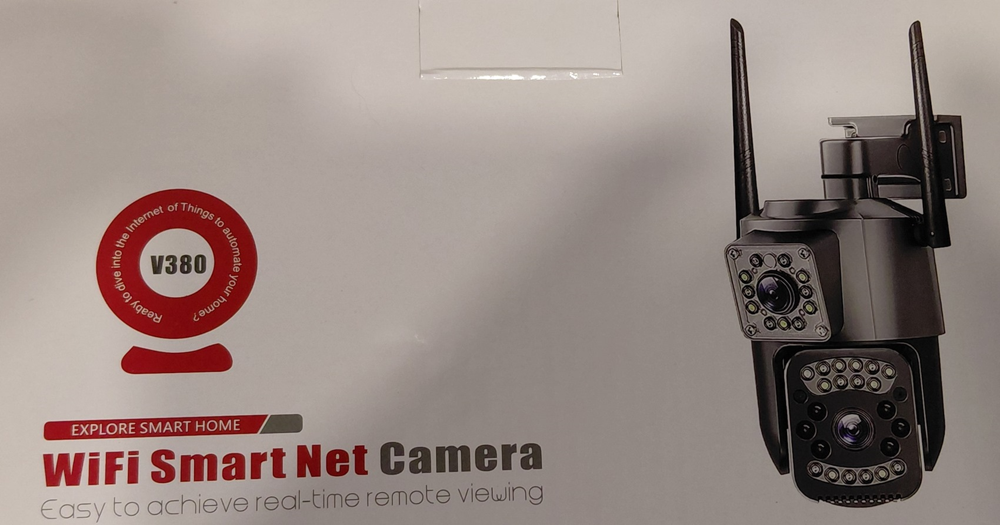

# V380 / V380 Pro: Device ID recovery

[Русский](README.md) · **English**

[](LICENSE)
[](MANIFEST.md)
[](https://github.com/ECD5A/v380-camera-device-id-recovery/actions/workflows/verify.yml)

The QR sticker is gone and the app has nothing to pair with. This repo shows how to pull the **Device ID of a V380 / V380 Pro camera** out through microSD: the camera writes the ID to a file on the card, you type it into V380 Pro by hand. The QR on the box often leads to the app download page, not to pairing.

[Quick start](#quick-start) · [Download the 3 files](releases/microSD-files-only.zip) · [Troubleshooting](docs/troubleshooting.md) · [Experiment log](docs/experiment-log.md) · [How it works](docs/technical-notes.md) · [Support](#support)



*Box from the tested camera. Photo: ECD5A.*

## Quick start

1. Download [`microSD-files-only.zip`](releases/microSD-files-only.zip) and unpack it **into the card root** (FAT32). No wrapper folder inside: the card must have exactly `local_update.conf`, `patch_reuse` and the `updatepatch/` folder.
2. Power the camera off, insert the card, power it on. Do not press Reset. If the camera announces an update, do not cut power.
3. After about 3 minutes power the camera off, take the card out and open `update_record` in Notepad. The `last_id=` line is the Device ID.
4. In V380 Pro: **+** → **Enter manually** → type the number.

No `update_record`? Then your firmware ignores this package. Stop there and leave the camera alone.

## Test results

| Item | Observation |
| --- | --- |
| Camera | One 4G/LTE IP camera with a **ZXInfoTek ZX800-VG** module. Board and processor unknown. |
| Recovery | The camera wrote `last_id` into `update_record`. V380 Pro accepted the number typed by hand, the owner confirmed the camera connected and worked. |
| Diagnostics | `V380_ID_RESULT/00_RESULT.txt` never appeared. Script execution is unconfirmed. |

Other 4G/LTE, Wi-Fi and Ethernet cameras are untested. `V380E6_G1` sits in the patch header, but that is not a confirmed `Hwname`. Hashes and provenance: [MANIFEST.md](MANIFEST.md).

The box says **"WiFi Smart Net Camera"** and **"Easy to achieve real-time remote viewing"**. The V380 Pro manual lists **WiFi Smart Camera** and **4G Smart Camera** as separate setups. [Packaging and wording](docs/technical-notes.md#packaging-and-wording)

> [!WARNING]
> The package goes through the stock firmware updater. On the wrong camera it can rewrite service data, hang the device or brick the firmware. Your camera, your risk.

## Instructions

1. Back up the videos you need. Format the card as **FAT32** if necessary. Ready-made set: [`releases/microSD-files-only.zip`](releases/microSD-files-only.zip).
2. Put **only** the contents of [`sdcard/`](sdcard/) into the card **root**:

   ```text
   microSD/
   ├── local_update.conf
   ├── patch_reuse             # empty on purpose
   └── updatepatch/
       └── 288032472d4d508105188fadf5a3ae8e.patch
   ```

3. Power the camera off, insert the card, power it on. **Do not press Reset**.
4. Wait about **3 minutes**. If the camera announces an update, **do not cut power** until it finishes.
5. After a normal boot (or a quiet boot with no update), power off, take the card out and open it on a PC.
6. Look for **`update_record`** with no extension in the card **root**. Example with **made-up** digits:

   ```ini
   [PATCH]
   last_id=123456789
   ```

7. If the line is there, tap **+** in V380 Pro, choose **Enter manually** and type the number. Menu names vary by app version.
8. Remove the update files from the card afterwards so the updater does not run again. Keep your own copy.

Only `RecFiles/record.ini`, or the app took the ID while the camera stays offline? See [troubleshooting](docs/troubleshooting.md).

`update_record` is a plain text file. Open it in Notepad, Notepad++ or TextEdit and look for `last_id=`. Nothing to install. Do not rename the file and do not post the value: it identifies your camera.

## What's in the repo

- [`sdcard/`](sdcard/) - **only the 3 card files**, no docs.
- [`source/exshell_bfu.sh`](source/exshell_bfu.sh) - the script from inside the patch; **do not** copy it to the card separately.
- [`tools/`](tools/) - offline check and rebuild. Python 3, no network.
- [`docs/experiment-log.md`](docs/experiment-log.md) - what was tried, what worked, what didn't.
- [`docs/troubleshooting.md`](docs/troubleshooting.md) - common cases.
- [`docs/technical-notes.md`](docs/technical-notes.md) - how the package works and where the proof ends.
- [`MANIFEST.md`](MANIFEST.md) - hashes, provenance, verification status.

## Checking the payload

One command, no camera needed:

```bash
python tools/check_payload.py
```

It checks SHA-256 of the three files, the patch MD5 and header, the contents of `releases/microSD-files-only.zip`, then rebuilds the patch from `source/` and compares byte for byte. Any mismatch is an error and a non-zero exit code.

`patch_reuse` must stay empty (**0 bytes**). If an editor writes text into it, the payload is no longer the tested one: download the ZIP again.

## Public reports

**Never post** your real Device ID, IMEI, serial number, QR contents, SIM data, MAC, Wi-Fi password or private video. Camera type, board revision (if you saw it), app version and whether `update_record` appeared are enough for a report.

## Project status

**Unofficial project.** Not associated with V380, V380 Pro or Macro-Video. No firmware images here.

## Support

If this saved you time:

- TON: `pointoncurve.ton`
- Bitcoin (BTC): `1ECDSA1b4d5TcZHtqNpcxmY8pBH1GgHntN`
- USDT (TRC20): `TUF4vPdB6QkjCvZq18rBL4Qj4dK5ihCN75`

Donations change nothing about the content: results are published as they are, failures included. These addresses live only here; forks can substitute them.

## Contact

Questions, reports about other models, pull requests:

<p>
  <a href="mailto:stelmak159@gmail.com" aria-label="Email"></a>
  &nbsp;
  <a href="https://t.me/ECDS4" aria-label="Telegram"></a>
  &nbsp;
  <a href="https://github.com/ECD5A/v380-camera-device-id-recovery" aria-label="GitHub repository"><picture><source media="(prefers-color-scheme: dark)" srcset="https://cdn.simpleicons.org/github/FFFFFF"></picture></a>
</p>
