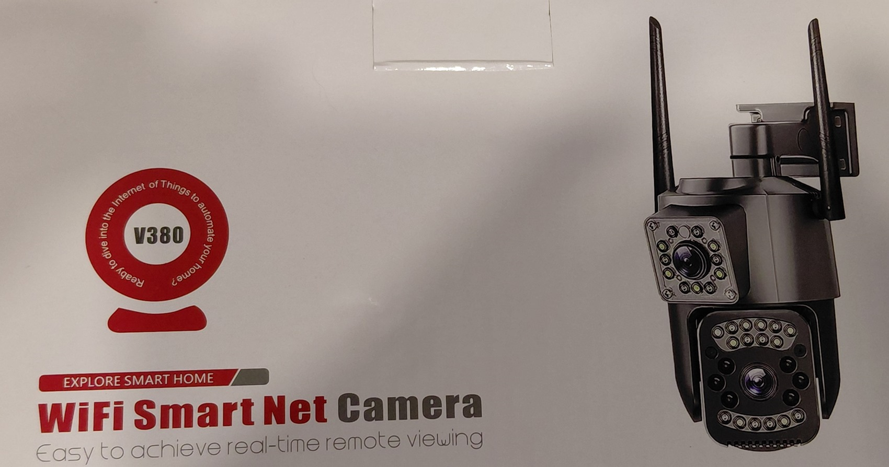

# V380 / V380 Pro IP-камера — восстановление Device ID

**Русский** · [English](README.en.md)

[](LICENSE)
[](MANIFEST.md)
[](https://github.com/ECD5A/v380-camera-device-id-recovery/actions/workflows/verify.yml)

Инструкция по восстановлению **Device ID IP-камеры V380 / V380 Pro** с помощью microSD, если наклейка с QR-кодом утеряна или повреждена. В V380 Pro идентификатор можно ввести вручную. QR-код на коробке может вести на страницу загрузки приложения.

[Инструкция](#инструкция) · [Скачать 3 файла](releases/microSD-files-only.zip) · [Проблемы и решения](docs/troubleshooting.md) · [Журнал эксперимента](docs/experiment-log.md) · [Технический разбор](docs/technical-notes.md) · [Поддержать](#поддержка-проекта)

## Коротко

1. Скачайте [`microSD-files-only.zip`](releases/microSD-files-only.zip) и распакуйте **в корень** карты (FAT32). Внутри нет вложенной папки: на карте должны лежать ровно `local_update.conf`, `patch_reuse` и папка `updatepatch/`.
2. Выключите камеру → вставьте карту → включите. Reset не нажимайте. Если камера объявила обновление — питание не отключайте.
3. Через ~3 минуты выключите камеру, достаньте карту и откройте `update_record` в Блокноте. Строка `last_id=` — это Device ID.
4. В V380 Pro нажмите **+** → **Ввести вручную** и введите номер.

Если `update_record` не появился, ваша прошивка этот пакет не обрабатывает — дальше экспериментировать на этой камере не нужно.

## Что проверено

| Параметр | Наблюдение |
| --- | --- |
| Камера | Одна IP-камера 4G/LTE с модулем **ZXInfoTek ZX800-VG**. Модель основной платы и процессор неизвестны. |
| Восстановление ID | Камера записала `last_id` в файл `update_record` на microSD. Приложение V380 Pro приняло этот номер при ручном вводе. По подтверждению владельца, камера подключилась и заработала. |
| Диагностический скрипт | Файл `V380_ID_RESULT/00_RESULT.txt` не появился. Выполнение скрипта остаётся неподтверждённым. |

Совместимость с другими 4G/LTE, Wi-Fi и Ethernet-камерами пока неизвестна. `V380E6_G1` указан в заголовке патча. Фактический `Hwname` камеры неизвестен. [Манифест](MANIFEST.md)



*Коробка камеры из эксперимента. Фото ECD5A.*

На коробке указано **«WiFi Smart Net Camera»** и **«Easy to achieve real-time remote viewing»**. В руководстве V380 Pro **WiFi Smart Camera** и **4G Smart Camera** описаны как отдельные категории подключения. [Маркировка и терминология](docs/keywords-and-packaging.md)

> [!WARNING]
> Пакет обрабатывается механизмом обновления прошивки. На несовместимой камере он может изменить служебные данные, вызвать зависание или повредить прошивку. Используйте его только на своей камере и на свой риск.

## Инструкция

1. Скопируйте нужные видеофайлы с microSD на компьютер. При необходимости отформатируйте карту в **FAT32**. Готовый набор из трёх файлов лежит в [`releases/microSD-files-only.zip`](releases/microSD-files-only.zip).
2. На карту в **корень** скопируйте **только** содержимое папки [`sdcard/`](sdcard/):

   ```text
   microSD/
   ├── local_update.conf
   ├── patch_reuse             # пустой файл, так и задумано
   └── updatepatch/
       └── 288032472d4d508105188fadf5a3ae8e.patch
   ```

3. Выключите камеру из питания. Вставьте microSD. Включите камеру. **Кнопку Reset не нажимайте**.
4. Подождите около **3 минут**. Если камера озвучила начало обновления — **питание нельзя отключать до завершения обновления**.
5. После нормальной загрузки/окончания обновления выключите питание, достаньте карту и откройте на ПК.
6. Ищите файл **`update_record`** без расширения в **корне microSD**. Пример с **вымышленным** номером:

   ```ini
   [PATCH]
   last_id=123456789
   ```

7. Если строка есть, нажмите **+** в V380 Pro, выберите **Ввести вручную** (*Enter manually*) и укажите Device ID. Названия пунктов меню зависят от версии приложения.
8. После проверки удалите с microSD файлы обновления во избежание повторного запуска (предварительно сохранив копию, если нужно).

Если появился только `RecFiles/record.ini` или приложение приняло ID, а камера осталась офлайн, см. [решения типовых проблем](docs/troubleshooting.md).

`update_record` — обычный текстовый файл. Откройте его Блокнотом (Notepad, Notepad++, TextEdit) и найдите строку `last_id=`. Ставить что-либо дополнительно не нужно. Не переименовывайте файл и не публикуйте значение: это уникальный идентификатор вашей камеры.

## Что содержит репозиторий

- [`sdcard/`](sdcard/) — **только 3 файла для microSD**, без документации и лишних папок.
- [`source/exshell_bfu.sh`](source/exshell_bfu.sh) — исходный текст скрипта внутри патча; на карту отдельно **не копировать**.
- [`tools/`](tools/) — офлайн-проверка пакета и детерминированная пересборка (Python 3, без сети).
- [`docs/experiment-log.md`](docs/experiment-log.md) — **что пробовали, что сработало и что не сработало**.
- [`docs/technical-notes.md`](docs/technical-notes.md) — структура пакета, гипотезы и ограничения.
- [`MANIFEST.md`](MANIFEST.md) — хеши, происхождение файлов и статус проверки.

## Проверка целостности

Команды выполняются на вашем компьютере, к камере они не обращаются.

```bash
python tools/verify_payload.py   # SHA-256 трёх файлов, MD5 патча, заголовок и встроенный скрипт
python tools/test_tools.py       # офлайн-сборка и сверка с releases/microSD-files-only.zip
```

`patch_reuse` должен остаться **файлом на 0 байт**. Если редактор или архиватор дописал в него текст, пакет перестаёт совпадать с проверенным — скачайте ZIP заново.

## Конфиденциальность

**Не публикуйте** действительный Device ID, IMEI, серийный номер, содержимое заводского QR-кода, SIM-данные, MAC, пароль Wi-Fi и личные видео. Для сообщений об успешной или неуспешной проверке достаточно указать тип камеры, известную ревизию платы, версию приложения и наличие файла `update_record` без раскрытия его содержимого.

## Поддержка проекта

Проект бесплатный и делается в свободное время. Если инструкция помогла вернуть камеру в строй и есть желание поддержать дальнейшие эксперименты:

- TON: `pointoncurve.ton`
- Bitcoin (BTC): `1ECDSA1b4d5TcZHtqNpcxmY8pBH1GgHntN`
- USDT (TRC20): `TUF4vPdB6QkjCvZq18rBL4Qj4dK5ihCN75`

Поддержка не влияет на содержание проекта: результаты тестов публикуются как есть, включая неудачные. Единственный источник адресов — этот файл в основном репозитории; в форках и копиях они могут быть подменены.

## Связь

Вопросы по восстановлению, отчёты о других моделях и предложения правок:

<p>
  <a href="mailto:stelmak159@gmail.com" aria-label="Email"></a>
  &nbsp;
  <a href="https://t.me/ECDS4" aria-label="Telegram"></a>
  &nbsp;
  <a href="https://github.com/ECD5A/v380-camera-device-id-recovery" aria-label="GitHub repository"><picture><source media="(prefers-color-scheme: dark)" srcset="https://cdn.simpleicons.org/github/FFFFFF"></picture></a>
</p>

**Независимый проект сообщества**, не официальный продукт V380 / Macro-Video. Оригинальные образы прошивки не распространяются. Материалы проекта — по [лицензии MIT](LICENSE).
